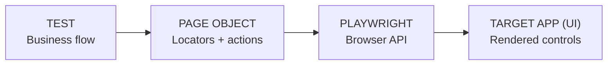
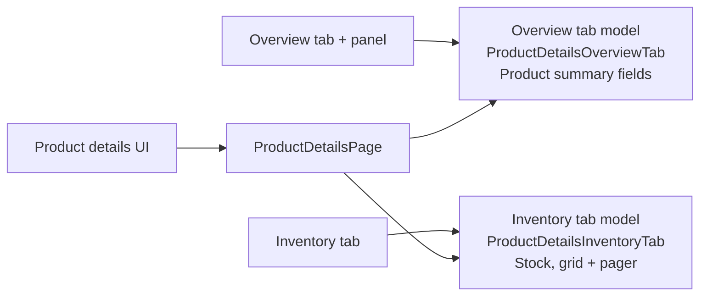
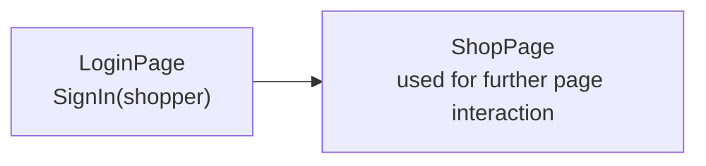

# E2E Testing Structure with Page Object Models

A proof of concept · MudBlazor · Playwright .NET · xUnit v3

**Salminger Andreas** · 27.10.2026

---

# Playwright: browser automation for E2E tests

Use .NET code to drive a real browser and check the experience from a user’s perspective.

<div class="grid grid-cols-2 gap-6">
<div>

### What it does
Opens a browser, performs user-like actions, and checks what the app shows. The same tests can run across Chromium, Firefox, and WebKit.

### Good starting practices

- **Choose stable locators:** use `data-testid` hooks or accessible roles.
- **Avoid brittle selectors:** don’t depend on page layout or CSS structure.
- **Let Playwright wait:** use retrying actions/assertions; avoid fixed sleeps.

</div>
<div>

```csharp
[Fact]
public async Task Shopper_signs_in()
{
    await Page.GetByTestId("login").ClickAsync();
    await Page.GetByTestId("email").FillAsync(account.Email);
    await Page.GetByTestId("submit").ClickAsync();
    await Expect(Page.GetByTestId("header"))
        .ToHaveTextAsync("Welcome");
    await Expect(Page.GetByTestId("logout")).ToBeVisibleAsync();
}
```

</div>
</div>

**Common APIs** · `GetByTestId(...)` · `ClickAsync()` · `FillAsync(...)` · `WaitForAsync(...)` · `Expect(...).ToBeVisibleAsync()`

---

# Baseline: a complete journey in raw Playwright

<div class="grid grid-cols-[24%_76%] gap-3">
<div>

### The business flow

1. **Manager** — restock product
2. **Shopper** — place an order
3. **Manager** — find the order

The test states the goal—then spends its lines describing browser mechanics.

</div>
<div class="baseline-code">

```csharp
public sealed class ManagerRestocksShopperOrdersTests : ShopDemoPageTest
{
    [Fact]
    public async Task Manager_can_restock_then_review_shopper_order()
    {
        await Page.GotoAsync("/");

        await Page.GetByTestId("nav-login-desktop").ClickAsync();
        await Page.GetByTestId("login-email").FillAsync(E2ETestSettings.StoreManager.Email);
        await Page.GetByTestId("login-password").FillAsync(E2ETestSettings.StoreManager.Password);
        await Page.GetByTestId("login-submit").ClickAsync();
        await Page.GetByTestId("nav-logout-desktop").WaitForAsync();

        await Page.GetByTestId("nav-inventory-desktop").ClickAsync();
        await Page.GetByTestId("inventory-page").WaitForAsync(new() { State = WaitForSelectorState.Visible });
        var inventoryItem = Page.GetByTestId($"inventory-item-{E2ETestSettings.CanvasToteId}");
        await inventoryItem.WaitForAsync(new() { State = WaitForSelectorState.Visible });
        await inventoryItem.GetByTestId($"inventory-stock-{E2ETestSettings.CanvasToteId}")
            .Locator("input")
            .FillAsync("4");
        await inventoryItem.GetByTestId($"inventory-save-{E2ETestSettings.CanvasToteId}").ClickAsync();
        await inventoryItem.GetByTestId($"inventory-current-stock-{E2ETestSettings.CanvasToteId}")
            .WaitForAsync(new() { State = WaitForSelectorState.Visible });

        await Page.GetByTestId("nav-logout-desktop").ClickAsync();
        await Page.GetByTestId("nav-login-desktop").WaitForAsync();
        await Page.GetByTestId("nav-login-desktop").ClickAsync();
        await Page.GetByTestId("login-email").FillAsync(E2ETestSettings.Shopper.Email);
        await Page.GetByTestId("login-password").FillAsync(E2ETestSettings.Shopper.Password);
        await Page.GetByTestId("login-submit").ClickAsync();
        await Page.GetByTestId("nav-logout-desktop").WaitForAsync();

        await Page.GetByTestId("nav-catalog-desktop").ClickAsync();
        await Page.GetByTestId("catalog-page").WaitForAsync(new() { State = WaitForSelectorState.Visible });
        var product = Page.GetByTestId($"product-card-{E2ETestSettings.CanvasToteId}");
        await product.GetByTestId($"product-add-{E2ETestSettings.CanvasToteId}").ClickAsync();
        await Page.GetByTestId("nav-cart-desktop").ClickAsync();
        await Page.GetByTestId("cart-checkout").ClickAsync();
        await Page.GetByTestId("checkout-name").FillAsync("Sample Shopper");
        await Page.GetByTestId("checkout-email").FillAsync(E2ETestSettings.Shopper.Email);
        await Page.GetByTestId("checkout-confirm").ClickAsync();
        var orderNumberLocator = Page.GetByTestId("checkout-order-number");
        await orderNumberLocator.WaitForAsync(new() { State = WaitForSelectorState.Visible });
        var orderNumber = await orderNumberLocator.InnerTextAsync();

        await Page.GetByTestId("nav-logout-desktop").ClickAsync();
        await Page.GetByTestId("nav-login-desktop").WaitForAsync();
        await Page.GetByTestId("nav-login-desktop").ClickAsync();
        await Page.GetByTestId("login-email").FillAsync(E2ETestSettings.StoreManager.Email);
        await Page.GetByTestId("login-password").FillAsync(E2ETestSettings.StoreManager.Password);
        await Page.GetByTestId("login-submit").ClickAsync();
        await Page.GetByTestId("nav-logout-desktop").WaitForAsync();
        await Page.GetByTestId("nav-orders-desktop").ClickAsync();

        Assert.True(await Page.GetByTestId($"order-card-{orderNumber}").CountAsync() > 0);
    }
}
```

</div>
</div>

---

# Baseline friction: details repeat, intent fades

Direct browser code is transparent—until scenarios grow.

<div class="grid grid-cols-2 gap-5">

### Intent is buried
Business goals hide among selectors, waits and clicks.

### Workflows repeat
Login, navigation and checkout recur across tests.

### Maintenance spreads
A UI change may touch many test bodies.

### Failure context is weak
When a test fails, it may only say which element was missing—not what the user was trying to do.

</div>

> **Goal:** keep Playwright’s clarity, but give repeated mechanics a useful home.

---

# Page Object Model (POM): UI knowledge behind a page

The test describes the flow; the page object owns locators and page-specific operations.



### A test can ask for work in the language of the journey

```csharp
public sealed class RestockTests : PageTest
{
    [Fact]
    public async Task Manager_updates_stock()
    {
        // page interaction logic
    }
}
```

**The boundary:** selectors and page operations are kept together. Broken selectors need to be fixed only in POM classes.

POM does not remove Playwright. It localizes Playwright knowledge.

---

# Page objects make repeated actions reusable

A named sign-in operation shortens the journey; selectors and waits are still manual.

<div class="grid grid-cols-2 gap-5">
<div>

### Journey excerpt

```csharp
public sealed class ShopJourneyTests : PageTest
{
    [Fact]
    public async Task Manager_restock_then_shopper_orders()
    {
        await Pages.Login.SignIn(manager);
        await Pages.Inventory.Open();
        await Pages.Inventory.UpdateStock(productId, 4);
        await Pages.Login.SignOut();
        await Pages.Login.SignIn(shopper);
        await Pages.Catalog.AddProductToCart(productId);
        await Pages.Cart.ProceedToCheckout();
        var order = await Pages.Checkout.PlaceOrder(name, email);
    }
}
```

</div>
<div>

### Page class + operation

```csharp
public sealed class LoginPage(IPage page)
{
    public async Task SignIn(DemoAccount account)
    {
        await page.GetByTestId("login-email").Fill(account.Email);
        await page.GetByTestId("login-password").Fill(account.Password);
        await page.GetByTestId("login-submit").Click();
        await page.GetByTestId("nav-logout-desktop").WaitFor();
    }
}
```

</div>
</div>

**What improves:** named, reusable page actions make the journey shorter and easier to scan.

**What remains:** selectors and readiness waits are still written repeatedly in each page class and page method.

**Locator readiness:** Playwright locators are lazy; actions and assertions auto-wait on use. A page-level required-element wait makes readiness consistent and surfaces missing-page failures at the boundary.

---

# Attribute-bound locators add a consistent readiness check

Declare locator metadata once. Creation binds properties and waits for required elements.

<div class="grid grid-cols-2 gap-5">
<div>

### Properties + operation

```csharp
public sealed class LoginPage(IPage page) : PageObject(page)
{
    [DataTestId("login-email")]
    public ILocator Email { get; private set; }

    [DataTestId("login-password")]
    public ILocator Password { get; private set; }

    [DataTestId("login-submit")]
    public ILocator Submit { get; private set; }

    public async Task<ShopPage> SignIn(DemoAccount account)
    {
        await Email.FillAsync(account.Email);
        await Password.FillAsync(account.Password);
        await Submit.ClickAsync();
    }
}
```

</div>
<div>

### What happens when created

1. Factory constructs the page object.
2. Binder resolves locator attributes.
3. Required elements are awaited visible.

</div>
</div>

**Less repeated locator wiring** · a shared page-ready rule · nested objects can be scoped to parent UI

---

# Complex pages can be split into focused sub-models

One `ProductDetailsPage` coordinates tabs; each tab model owns its own features.

<div class="grid grid-cols-2 gap-5">
<div>

### ShopDemo · Product details

**Market Canvas Tote**  
Product ID: `canvas-tote` · $24.00

| Overview | Inventory |
|:--|:--|
| **Overview panel** | |
| Name · description · category · price | |

</div>
<div>

### ProductDetailsPage · parent POM

```csharp
public sealed class ProductDetailsPage : PageObject
{
    [DataTestId("product-overview-tab")]
    public ILocator OverviewTab { get; private set; }

    [DataTestId("product-inventory-tab")]
    public ILocator InventoryTab { get; private set; }

    public async Task<ProductDetailsInventoryTab> SwitchToInventoryTab()
    {
        await InventoryTab.Click();
        var panel = Page.GetByTestId("product-inventory-panel");
        return await Create<ProductDetailsInventoryTab>(panel);
    }
}
```

</div>
</div>



Scoped child models keep tab features isolated; bind them when the panel is activated.

---

# Page transitions return the next page object

Use descriptive names: a `LoginPage` signs in; sign-in returns the authenticated `ShopPage` model.



<div class="grid grid-cols-2 gap-5">
<div>

### Test uses the returned model

```csharp
public sealed class ShoppingFlowTests : PageTest
{
    [Fact]
    public async Task Shopper_signs_in()
    {
        var shopPage = await login.SignIn(shopper);

        // interaction logic with shopPage ...
        shopPage.AddToCart(...);
    }
}
```

</div>
<div>

### LoginPage transition

```csharp
public async Task<ShopPage> SignIn(DemoAccount account)
{
    await Email.Fill(account.Email);
    await Password.Fill(account.Password);
    await Submit.Click();

    // creates ShopPage and ensures readiness
    return await Create<ShopPage>();
}
```

</div>
</div>

**Typed hand-off:** the return type documents the next page.  
**Readiness stays local:** created after sign-in is confirmed.

---

# Static helpers centralize control quirks

A shared helper hides `MudSelect` internals. The test still supplies the locator.

<div class="grid grid-cols-2 gap-5">
<div>

### Test reference · Forms showcase

```csharp
public sealed class FormControlsShowcaseTest : E2ETestBase
{
    [Fact]
    public async Task Select_option_updates_display()
    {
        var select = Page.GetByTestId("select-nullable-int");
        await E2ESelectHelper.SelectOption(select, "Value 1");
        await E2ESelectHelper.AssertDisplayValue(select, "Value 1");
    }
}
```

</div>
<div>

### Select helper · excerpt

```csharp
public sealed class E2ESelectHelper
{
    public static async Task SelectOption(
        ILocator selectInput, string optionText)
    {
        var selectControl = ... // find correct control
        var openPopover = ... // find dropdown popover

        // further logic to click correct option in popover ...
    }
}
```

</div>
</div>

| Advantage | Limit |
|:--|:--|
| Centralizes MudBlazor-specific behavior: hidden input, visible combobox, popover options. | Caller still finds and passes a generic `ILocator`. Lots of static class calls can make test code harder to read. |

---

# Typed controls give common widgets a focused API

`CheckoutPage` declares widget types; reusable controls own the interaction details.

<div class="grid grid-cols-2 gap-5">
<div>

### Checkout page object

```csharp
public sealed class CheckoutPage : PageObject
{
    [Locator(DataTestId, "checkout-name")]
    public required TextField Name { get; init; }

    [Locator(DataTestId, "checkout-confirm")]
    public required Button Confirm { get; init; }

    public async Task PlaceOrder(string name)
    {
        await Name.Fill(name);
        await Confirm.Click();
    }
}
```

#### Button control

```csharp
public sealed class Button : Control
{
    public async Task Click()
    {
        Trace("Clicking button");
        await Locator.ClickAsync();
    }
}
```

#### Test

```csharp
public sealed class CheckoutTests : PageTest
{
    [Fact]
    public Task PlaceOrder()
        => Checkout.PlaceOrder("Sample Shopper");
}
```

</div>
<div>

### Sample control types

| Type | Typical features |
|:--|:--|
| **TextField** | Fill · read value |
| **NumericField** | Typed numeric values |
| **Button** | Click · read text |
| **Select** | Pick option · read selected text |
| **Tab** | Select · wait for selected state |
| **DataGrid + Pager** | Rows, cells and page navigation |

> MudBlazor-specific root resolution and waits stay inside the reusable control.

</div>
</div>

---

# Select: from helper call to typed page control

The locator moves onto the page object; `Select` behavior stays with the reusable control.

<div class="grid grid-cols-2 gap-5">
<div>

### Static helper

#### Test class + method · caller locator

```csharp
public sealed class SelectTests : PageTest
{
    [Fact]
    public async Task SelectCategory()
    {
        var select = Page.GetByTestId("catalog-category");
        await E2ESelectHelper.SelectOption(select, "Bags");
    }
}
```

#### Helper behavior

```csharp
public static async Task SelectOption(ILocator input, string value)
{
    var popover = await OpenPopover(input);
    await E2EPopoverHelper.SelectOption(popover, value);
}
```

</div>
<div>

### Typed page property

#### Test class + method · page operation

```csharp
public sealed class CatalogTests : PageTest
{
    [Fact]
    public async Task FilterByCategory()
    {
        await Catalog.FilterByCategory("Bags");
    }
}
```

#### CatalogPage property + method

```csharp
[Locator(DataTestId, "catalog-category")]
public required Select Category { get; init; }

public Task FilterByCategory(string value)
    => Category.SelectOption(value);
```

</div>
</div>

**Less locator plumbing in tests** · stronger control intent · one shared place for widget-specific behavior

---

# From browser mechanics to an intentional test model

Compare with the full baseline: same business goal, a clearer test boundary.

<div class="grid grid-cols-2 gap-5">
<div>

### Inline Playwright · scattered low-level detail

```csharp
public async Task Manager_restock_then_order()
{
    await Page.GetByTestId("nav-login").Click();
    await Page.GetByTestId("login-email").Fill(manager.Email);
    await Page.GetByTestId("login-submit").Click();
    await Page.GetByTestId("nav-inventory").Click();
    // selectors, waits, cart, checkout, sign-outs…
    await Page.GetByTestId("checkout-confirm").Click();
    // find order after another sign-in and navigation
    // ...
}
```

</div>
<div>

### Structured page objects · page-level business flow

```csharp
public sealed class ShopJourneyTests : PageTest
{
    [Fact]
    public async Task Manager_restock_then_shopper_orders()
    {
        var manager = await SignIn(Manager);
        await manager.Restock(productId, 4);
        var shopper = await SignIn(Shopper);
        await shopper.AddToCart(productId);
        var order = await shopper.PlaceOrder(name, email);
        await manager.FindOrder(order);
    }
}
```

</div>
</div>

<div class="grid grid-cols-4 gap-3">

**Readable**  
Business intent stands out.

**Reusable**  
Page actions and controls have names.

**Maintainable**  
UI changes stay near their model.

**Consistent**  
Binding and widget behavior are shared.

</div>

*Add abstraction when reuse and consistency repay the framework cost.*

<style>
.baseline-code pre {
  font-size: 10px !important;
  line-height: 1.12 !important;
}
</style>

